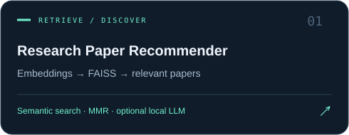
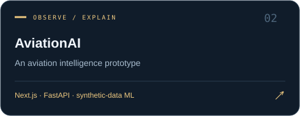
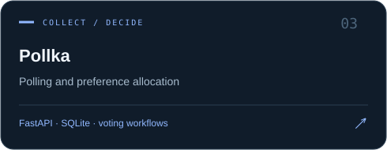
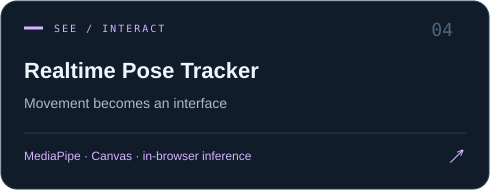
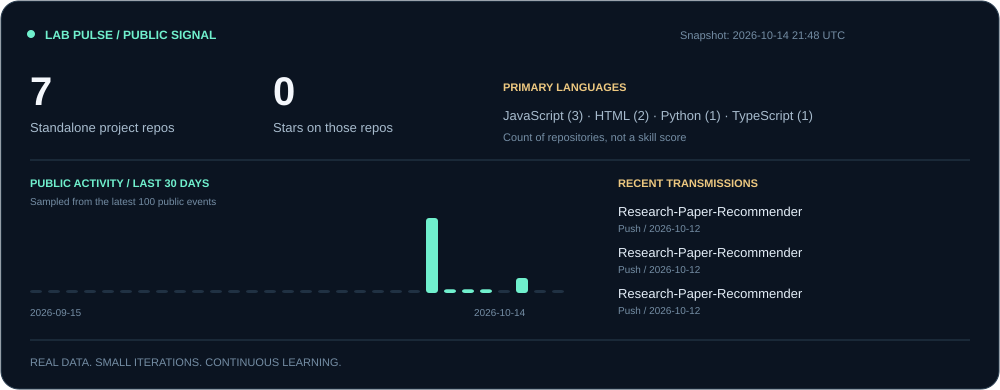

  

  
  
  

### A little context

I'm **Hamza**, a Computer Science undergraduate at **SRM Institute of Science and Technology**, graduating in **June 2027**. Previously, I interned in **Data Science at Lowe's India**, working on data pipelines and a retrieval-augmented AI assistant with Gemma and REST APIs.

I like the space where **retrieval, machine learning and product engineering** meet: taking a model or an idea and building something people can actually use. Currently exploring **AI/ML, data and software internships across India**.

### Selected experiments

<table>
<tr>
<td width="50%"></td>
<td width="50%"></td>
</tr>
<tr>
<td width="50%"></td>
<td width="50%"></td>
</tr>
</table>

These are learning and research prototypes. Project READMEs describe their data, evaluation and deployment limits. Forked work is attributed in its repository.

### My working toolkit

**AI & data** · Python · pandas · NumPy · scikit-learn · XGBoost · FAISS · SHAP  
**Applications** · FastAPI · React · Next.js · JavaScript · TypeScript  
**Workflow** · Git · SQL · REST APIs · Postman

### Lab pulse

Generated from public GitHub data. The activity bars count sampled public events, not contribution squares or total commits. A scheduled workflow checks for changes every six hours; GitHub scheduling and image caching can delay updates.

<b>What I'm working toward</b>

- Better retrieval: relevant results, clear sources and measurable quality.
- Honest ML evaluation: preventing leakage and separating demos from validated results.
- Reliable software: useful tests, clear setup and understandable failure states.

---

<b>Have an interesting problem?</b> <a href="https://www.linkedin.com/in/hamza-khan-48415518a">Let's talk.</a> Build thoughtfully. Measure honestly. Keep learning.

